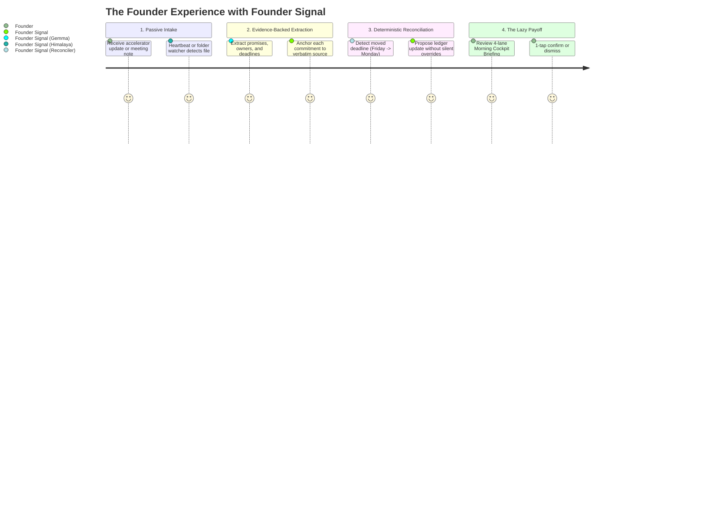
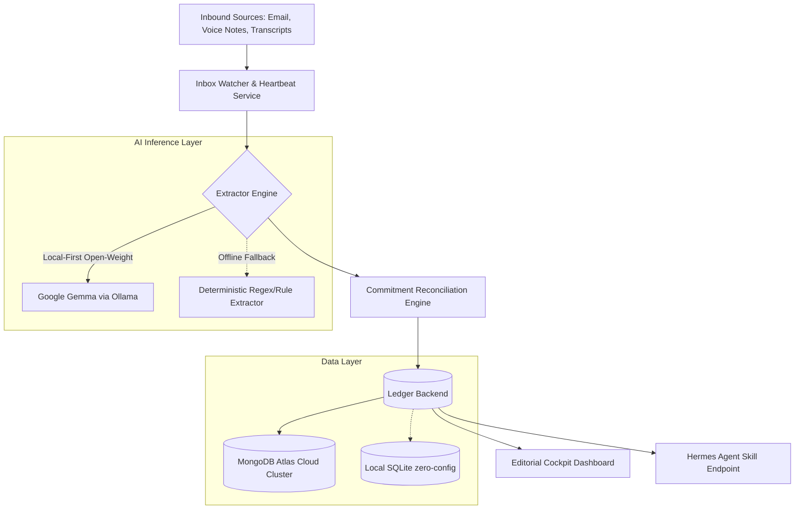

*This article is submitted for the **Hacktoberfest Open-Source AI Challenge: Week 3 (Slow and Steady)**.*  
*Target Categories: **Overall Winner**, **Best Use of Gemma**, **Best Use of MongoDB Atlas**.*


---

## 1. The Real-World "Sloth" Problem: Commitment Drift

October 20 was **International Sloth Day**. Sloths understand something fundamental about energy conservation: they move at their own pace, avoid wasted motion, and let the world come to them.

Early-stage founders, on the other hand, do the exact opposite. We drown in operational motion. Every day brings a barrage of accelerator emails, co-founder syncs, investor requests, and forwarded meeting notes:
- *"I'll send the updated pitch deck by Friday morning."*
- *"We should review the contractor's contract on Tuesday."*
- *"Sarah mentioned she needs the revised financial projections by Monday at 2 PM."*

Three days later, a follow-up email moves the deadline from Friday to Monday. Another message asks if anyone followed up on the investor introductions.

Without automation, staying on top of this is an exhausting cognitive tax. Founders end up constantly rereading email threads, copying fragmented tasks into todo apps, manually checking dates, and worrying that a promised deliverable slipped through the cracks.

**Founder Signal** fixes that by automating the tracking overhead completely. You channel your inner sloth: the system quietly ingests your inbound communications, extracts promises and deadlines, reconciles changes against your ledger, and delivers a tiny, high-conviction morning briefing.

**The agent proposes; you confirm. You only expend energy when a real decision is required.**

---

## 2. What I Built: Founder Signal

Founder Signal is a local-first, evidence-backed commitment extraction and reconciliation ledger designed specifically for founders.

Unlike typical chatbots or simple summarizers that produce vague bullet points, Founder Signal anchors every extracted commitment to **verbatim source text** and reconciles new information against existing promises.



### The 4-Stage Pipeline:

1. **Passive Ingestion**:
   - Drops incoming email text, voice-note audio (`.mp3`, `.wav`), or meeting transcripts into a local inbox folder.
   - An automated background heartbeat pulls new emails directly from configured email accounts (e.g., Zoho, Gmail) via the CLI.
2. **Deterministic & Open-Weight Extraction**:
   - Parses commitments, owners, due dates, decisions, and follow-ups.
   - Every single commitment is anchored to verbatim evidence quotes.
3. **Smart Reconciliation (The Real Differentiator)**:
   - If an email moves a deadline from Friday to Monday, Founder Signal identifies the existing commitment, flags the change, and stages the update.
   - Retains both source quotes so the founder always knows *why* a date shifted.
4. **The Cockpit Briefing**:
   - Synthesizes the ledger into four crisp priority lanes:
     - ⚡ **Do Now**: High-priority obligations due today or overdue.
     - 🗓️ **Coming Up**: Upcoming deliverables scheduled within the next 7 days.
     - ⏳ **Waiting On Someone**: Promises made by external counterparties (co-founders, investors, contractors).
     - 🔍 **Needs Clarification**: Commitments missing explicit assignees or concrete deadlines.

---

## 3. Architecture & Tech Stack

Founder Signal was engineered with privacy, reliability, and modularity at its core.



### Stack Highlights:
- **Core LLM**: **Gemma** open-weight model (`gemma4:e2b-it-qat`) running locally via Ollama. No sensitive pitch decks or private investor correspondence ever leave the founder's machine.
- **Ledger Storage**: **MongoDB Atlas** (`pymongo`) for durable, scalable cloud storage of sources, extracted commitments, and reconciliation audit trails, with an offline SQLite fallback.
- **Email Ingestion**: Native integration with the Himalaya CLI and Linux `systemd` user service running a reliable 15-minute background heartbeat.
- **Web Interface**: Lightweight editorial cockpit UI rendered with Flask, featuring a high-contrast attention-first layout in warm ivory, spruce teal, and amber.
- **Hermes Agent Integration**: Exposes a standard Hermes-compatible skill protocol (`GET /skills/founder-signal/manifest` and `POST /skills/founder-signal/invoke`).

---

## 4. The Lazy Payoff: Time & Effort Saved

How much time does this actually save?

| Weekly Activity | Manual Status Quo | With Founder Signal |
|---|---|---|
| Rereading email threads for deliverables | 20–30 mins/wk | 0 mins (automated) |
| Copying tasks & dates into notes/todo apps | 15–20 mins/wk | 0 mins (automated) |
| Spotting moved deadlines & resolving conflicts | 10–15 mins/wk | 1 min (review proposals) |
| Preparing daily priorities & follow-ups | 10–15 mins/wk | 1 min (scan Cockpit brief) |
| **Total Cognitive Overhead** | **~60–80 minutes/wk** | **~2 minutes/wk** |

**Estimated time saved: Over 1 hour per week** of tedious administrative chore time. More importantly, it completely eliminates the low-level anxiety of wondering *"Did I forget something I promised in that email thread on Thursday?"*

---

## 5. Live Demo & How to Run It

To make testing instant for hackathon judges and readers, Founder Signal includes an offline, reproducible demo script that demonstrates the full ingest → extract → reconcile → brief flow in under 10 seconds:

```bash
git clone https://github.com/AnthonyASBaptiste/founder-signal.git
cd founder-signal
pip install -r requirements.txt
cp .env.example .env
FOUNDER_NAME=Anthony bash demo/demo.sh
```

### What the demo script executes:
1. Ingests an authentic accelerator update email (`demo/samples/accelerator-update.txt`), extracting commitments with verbatim evidence.
2. Ingests a schedule adjustment (`demo/samples/schedule-change.txt`), demonstrating how reconciliation identifies that Sarah's deck deadline shifted from Friday to Monday.
3. Applies the change with `--apply` and outputs the updated morning cockpit briefing.

👉 **Source Code**: [github.com/AnthonyASBaptiste/founder-signal](https://github.com/AnthonyASBaptiste/founder-signal)

---

## 6. Why Open Innovation Matters

For a founder or executive, **privacy and confidentiality are non-negotiable**.

A commitment ledger contains the lifeblood of a startup: unannounced product launch targets, runway discussions, confidential investor introductions, contract disputes, and sensitive customer commitments. Uploading this continuously to proprietary commercial cloud AI models introduces serious data sovereignty and privacy risks.

Open innovation provides the ideal architecture:
1. **Zero Data Egress**: Using open-weight models like Google Gemma running locally, all document parsing and semantic reasoning happen in local RAM. Not a single token is transmitted off-device.
2. **Cost Predictability**: Offline inference costs \$0/month. There are no surprise monthly API bills, token limits, or sudden tier changes.
3. **Auditable & Resilient**: The deterministic rule fallback guarantees that even if an AI service is unavailable or an API key expires, the core ledger extraction and reconciliation continue functioning seamlessly.

---

## 7. Prize Categories Entered

- [x] **Theme: Slow and Steady** — Rewards laziness by automating commitment capture and date reconciliation so founders can conserve energy and focus purely on high-leverage execution.
- [x] **Best Use of Gemma** — Uses Google's open-weight **Gemma** (`gemma4:e2b-it-qat`) via Ollama as the local-first intelligence layer, achieving fast, private, and deterministic JSON extraction without data leaks.
- [x] **Best Use of MongoDB Atlas** — Uses **MongoDB Atlas** as the production multi-collection ledger (`sources`, `commitments`), providing high-availability cloud storage, flexible schema handling for evolving metadata, and sub-millisecond query indexing.
